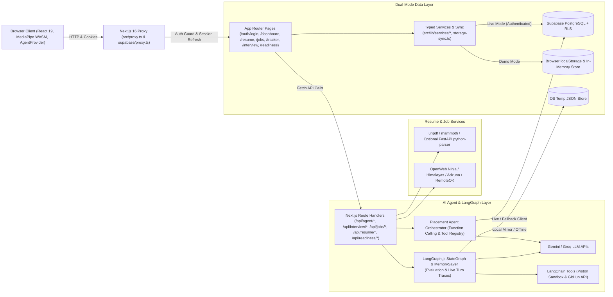

# Placement Co-pilot

> Your Autonomous AI-Powered Placement Preparation Companion.

[](https://nextjs.org/)
[](https://react.dev/)
[](https://www.typescriptlang.org/)
[](https://tailwindcss.com/)
[](https://supabase.com/)
[](https://langchain-ai.github.io/langgraphjs/)

**Placement Co-pilot** is an end-to-end campus placement and software engineering interview preparation platform built with Next.js 16 App Router, Supabase PostgreSQL with Row-Level Security (RLS), Google Gemini / Groq inference, and LangGraph.js multi-turn interview workflows.

- **Repository:** [github.com/MananHindocha/placement-copliot](https://github.com/MananHindocha/placement-copliot)
- **Status:** Active development (Full-stack Supabase auth + RLS, Autonomous Agent Orchestration, Live AI Interviewer, Coding Arena, and Dual Demo/Live Mode implemented).

---

## Table of Contents

- [Overview](#overview)
- [Key Features](#key-features)
- [Technology Stack](#technology-stack)
- [System Architecture](#system-architecture)
- [Project Structure](#project-structure)
- [Getting Started](#getting-started)
- [Environment Variables](#environment-variables)
- [Application Usage](#application-usage)
- [AI Agent Architecture](#ai-agent-architecture)
- [Database and Persistence](#database-and-persistence)
- [Screenshots](#screenshots)
- [Development and Contribution](#development-and-contribution)
- [Roadmap](#roadmap)
- [License and Credits](#license-and-credits)

---

## Overview

Preparing for technical placements typically involves switching between disconnected tools: resume editors, generic ATS checkers, job portals, application spreadsheets, DSA judges, and isolated mock interview tools. Because those systems do not share context, weaknesses uncovered in mock interviews rarely update study priorities, and resume edits are disconnected from real project evidence or target roles.

Placement Co-pilot unifies these stages around a shared candidate context (**Student Digital Twin**):

1. **Evidence-Grounded Profile**: Uploaded resumes (PDF/DOCX) are parsed into structured skills, projects, and work experience and stored in a skill evidence matrix with bluff-risk tracking.
2. **Role-Aligned Discovery & Tracking**: Target role selection drives multi-provider job discovery, match scoring, and 6-stage Kanban pipeline management.
3. **Adaptive Cross-Examination**: LangGraph.js interview workflows test candidates across multi-turn technical conversations, GitHub codebase deep-grills, custom JD scenarios, and OA coding challenges—writing verified skill changes and remedial study tasks back to the candidate's Study Plan.
4. **Dual-Mode Execution**: Supports authenticated persistence backed by Supabase PostgreSQL + RLS as well as a zero-config **Demo Mode** for immediate local exploration.

---

## Key Features

### 1. Resume Intelligence
- **Multi-Format Upload & Extraction** (`/resume`, `/api/resume/parse`, `/api/resume/analyze`): Supports PDF and DOCX resumes using `unpdf`, native `zlib` stream decompression fallback, `mammoth`, and an optional companion FastAPI `python-parser` microservice (`PyMuPDF`, `pypdf`, `pdfplumber`, `python-docx`).
- **Structured Parsing & ATS Scoring**: Extracts candidate name, technical skills with claimed confidence levels, project histories, work experience, missing role skills, and STAR-formatted bullet improvements.
- **Role/JD Matching & Editing**: Compares resumes against target job descriptions, lets users accept/edit suggestions in an editable resume sheet, and exports formatted print HTML/PDF resumes (`generateResumePrintHtml`).

### 2. Autonomous Placement Agent
- **Unified Agent Banner & Trace Drawer** (`IntegratedRobotNavigator`, `ExecutionTraceDrawer`, `/api/agent/*`): Available on Home (`/dashboard`) and My Resume (`/resume`). Users choose a target role, upload a resume, or run focused actions (**Live Jobs**, **Study Plan**, **Mock Interview**, **Deadlines / Kanban**).
- **Gemini Function-Calling Loop** (`src/lib/agent/orchestrator.ts`): Plans and executes read/write tool calls (`analyze_job_gap`, `inject_readiness_sprint`, `stage_resume_diff`, `update_skill_evidence`, `optimize_multi_company_overlap`, `sync_digital_twin_from_resume`, `auto_seed_kanban_pipeline`) with run-level idempotency keys and reasoning traces.
- **Human-in-the-Loop Approvals** (`/api/agent/approvals`, `ResumeDiffApprovalCard`): Agent-proposed resume bullet changes are staged into `agent_approvals` with `PENDING` status and require explicit user approval (`APPROVED` / `REJECTED`) before modifying resume bullets.
- **Digital Twin Skill Matrix & Bluff Audit** (`DigitalTwinMatrix`, `BluffRiskAuditModal`, `SkillMicroProbeModal`): Distinguishes claimed resume skills from verified interview/assessment confidence (`UNVERIFIED` -> `LOW` -> `MEDIUM` -> `HIGH`).
- *Implementation note*: General autonomous agent goals require `GOOGLE_GENERATIVE_AI_API_KEY` (or `GEMINI_API_KEY`) and return explicit errors when missing, while focused UI actions (`jobs`, `kanban`, `readiness`) include direct tool fallbacks if the LLM endpoint is unavailable.

### 3. Job Discovery
- **Multi-Provider Live Job Search** (`/jobs`, `/api/jobs/search`): Queries configured providers in cascade order (**OpenWeb Ninja JSearch** -> **Himalayas** -> **Adzuna** -> public **RemoteOK**) with in-memory TTL caching and request deduplication. Returns empty results honestly when providers return nothing rather than injecting mock listings.
- **Filtering & Profile Matching** (`/api/jobs/match`): Filters by query, location, arrangement (`remote`/`hybrid`/`onsite`), recency, experience, and employment type; ranks jobs against user skills via Gemini with a deterministic heuristic fallback; supports saving roles directly to the Kanban tracker.

### 4. Application Tracking
- **6-Stage Kanban & List Views** (`/tracker`): Tracks applications across `Wishlist`, `Applied`, `Phone Screen`, `Interview`, `Offer`, and `Rejected`.
- **Pipeline Operations**: Supports manual additions, job URL import (`JobImportModal`), status transitions, deadline provenance metadata (`verified_source`, `user_entered`, `unknown`), Company War Room diagnostics (`CompanyWarRoomModal`), and Supabase/localStorage sync.

### 5. AI Interview Preparation
- **Live Autonomous AI Interviewer** (`/interview/question-bank`, `LiveAgentInterviewRoom`, `/api/interview/agent-turn`):
  - Multi-turn adaptive technical interview (up to 6 turns) built with LangGraph.js trace execution (`executeLiveTurnTraceGraph`).
  - Supports **Voice Input** (`MediaRecorder` -> `/api/interview/transcribe` using Groq Whisper `whisper-large-v3-turbo`/`whisper-large-v3` with Gemini multimodal audio fallback), browser `speechSynthesis` audio playback, **Type Text Answer**, and a **Code Scratchpad**.
  - Detects 30-second thinking pauses to offer proactive hints, mutates `skill_evidence_matrix` per turn, injects remedial Study Plan tasks when gaps are detected, and generates a structured final debrief.
- **Resume & GitHub Project Deep-Grill** (`/interview/resume-grill`, `LiveProjectGrillRoom`, `/api/interview/github-grill`):
  - Inspects public GitHub repositories via LangChain's `inspectGitHubRepoTool` (tree scan, README, dependency manifests, commits, and up to 6 prioritized core source files) to generate file- and function-specific architecture defense and failure-recovery questions.
- **Custom JD & Role Question Bank** (`/interview/question-bank/[role]`, `/interview/customize`, `/api/interview/custom-jd`, `/api/interview/custom-questions`, `/api/interview/evaluate`): Generates role-specific and company-preset interviews with LangGraph.js STAR + adaptive difficulty branching (`level_up_escalator_node`, `probe_deeper_node`, `calibrate_foundation_node`).

### 6. DSA and Coding Preparation
- **Curated OA Problemset & Company Lists** (`/interview/dsa`, `/api/interview/company-problems`): Includes **30** built-in OA coding problems (`src/lib/dsa-oa-questions.ts`) across 9 algorithmic topics in Python, TypeScript, C++, and Java, plus dynamic company-specific problem lists fetched from GitHub CSV sources.
- **Coding Arena & Evaluation** (`/interview/dsa/[questionId]`, `DsaCodingArena`, `DsaProblemWorkspace`): Split-pane IDE editor with custom test inputs, Big-O complexity claims, verbal explanation capture, hints, and `localStorage` solved/attempted status tracking.
  - `/api/interview/dsa-execute` executes code via LangChain's `executeSandboxCodeTool` (Piston API) paired with LLM complexity/bluff review, falling back cleanly to static trace telemetry when Piston is unavailable or returns HTTP 401.
  - `/api/interview/run-code` performs LLM-simulated dry-run test evaluation and code review (with deterministic keyword heuristics when LLM keys are unconfigured) rather than local OS container compilation.

### 7. Vision-Based Interview Assistance *(Client-Side Experimental/Assistive Telemetry)*
- **On-Device MediaPipe CV** (`src/components/interview/VisionProctorStage.tsx`): Uses `@mediapipe/tasks-vision` (`FaceLandmarker` and `HandLandmarker` WebAssembly delegates and models loaded from CDN) to compute real-time eye contact, gaze direction, head posture, ambient frame brightness, and hand-gesture/fidgeting heuristics (`CvTelemetrySnapshot`).
- **Privacy & Controls**: Video frames stay strictly in the browser and are never uploaded or stored. In Technical Interviews (`variant="sidebar"`, `autoStart={false}`), camera monitoring is **off by default** and opt-in; in Project Deep-Grill (`variant="full"`), the video stage mounts with live controls. Requires browser camera permissions and network access to load MediaPipe WASM/model assets.

### 8. Readiness Planner & Preparation Schedule
- **Study Plan & Milestones** (`/readiness`, `/api/readiness/recommendations`): Organizes actionable preparation tasks across `resume`, `skills`, `network`, `interview`, and `applications` categories with priority, due dates, progress breakdown, and AI milestone recommendations.
- **Home-Exclusive Preparation Schedule** (`PreparationSidebar`, `src/lib/preparation-sync.ts`): Fixed right-hand monthly calendar on `/dashboard` (and mobile drawer) aggregating scheduled milestones, past interview sessions, application activity, and DSA solved counts.

---

## Technology Stack

| Layer | Technologies Used | Purpose |
| :--- | :--- | :--- |
| **Framework & Runtime** | Next.js `16.4.2` (App Router, Turbopack, `proxy.ts`), React `19.3.0`, TypeScript `^5` | Server/Client rendering, route protection, API route handlers |
| **Styling & UI** | Tailwind CSS `^4`, `@tailwindcss/turbopack ^4`, `clsx ^2.1.1`, `lucide-react ^1.60.0` | True-black (`#000000` / `#0D0D0D`) minimal design system & iconography |
| **Database & Auth** | Supabase (`@supabase/supabase-js ^2.118.0`, `@supabase/ssr ^0.12.7`), PostgreSQL | SSR cookie sessions, user auth, 13 relational tables with Row-Level Security |
| **Agent & Interview Graphs** | `@langchain/langgraph ^1.7.3`, `@langchain/core ^1.3.7`, `zod ^4.6.7` | StateGraph adaptive interviews, MemorySaver checkpointer, structured tools |
| **LLM & Speech Providers** | Google Gemini REST API (`gemini-*`), Groq API (`llama-*`, `whisper-large-v3-turbo`), xAI Grok (resume fallback) | Autonomous function calling, STAR evaluation, code review, audio STT |
| **Resume Parsing** | `unpdf ^2.0.0`, `mammoth ^1.13.0`, `zlib`, optional FastAPI (`PyMuPDF`, `pypdf`, `pdfplumber`, `python-docx`) | Multi-tier PDF/DOCX extraction and structured JSON parsing |
| **Computer Vision** | `@mediapipe/tasks-vision ^1.2.2` (`FaceLandmarker`, `HandLandmarker`) | Local browser gaze, posture, lighting, and hand-telemetry tracking |
| **Code & Repo Tools** | Piston Execute API (`emkc.org` / configurable), GitHub REST API v3 | DSA code execution tool and public GitHub repository inspection |

---

## System Architecture



---

## Project Structure

```text
placement-copliot/
├── AGENTS.md                         # Next.js 16 agent development notice
├── PROJECT_OVERVIEW.md               # Legacy architectural reference
├── docs/
│   ├── FULL_PROJECT_IMPLEMENTATION.md
│   └── SUPABASE_SETUP.md             # Supabase setup, RLS & migration guide
├── public/                           # Default static SVG assets
├── python-parser/                    # Optional FastAPI PDF/DOCX extractor microservice
│   ├── main.py
│   └── requirements.txt
├── supabase/
│   └── migrations/                   # SQL schema & RLS policy migrations
│       ├── 20261021000000_initial_schema.sql
│       ├── 20261029120000_resume_analysis_payload.sql
│       ├── 20261029133000_job_application_provenance.sql
│       └── 20261108_agentic_core.sql
├── src/
│   ├── proxy.ts                      # Next.js 16 proxy: entry routing, auth/demo guards, SSR refresh
│   ├── app/
│   │   ├── page.tsx                  # Root entry router (/) -> /auth/login or /dashboard
│   │   ├── layout.tsx                # RootLayout wrapping AgentProvider & AppShell
│   │   ├── auth/                     # /auth/login & /auth/callback
│   │   ├── dashboard/                # /dashboard Home view + PreparationSidebar layout
│   │   ├── resume/                   # Resume upload, ATS scoring & interactive editor
│   │   ├── jobs/                     # Multi-provider job search & skill match scoring
│   │   ├── tracker/                  # Kanban & tabular application pipeline
│   │   ├── readiness/                # Study Plan milestones, Digital Twin & overlap analysis
│   │   ├── interview/                # Landing, question-bank, resume-grill, customize, dsa
│   │   └── api/                      # 20 server route handlers (agent, interview, jobs, resume, readiness, system)
│   ├── components/
│   │   ├── agent/                    # Robot navigator, trace drawer, HITL approvals, Digital Twin UI
│   │   ├── interview/                # LiveAgentInterviewRoom, LiveProjectGrillRoom, DsaCodingArena, VisionProctorStage
│   │   ├── layout/                   # AppShell, Sidebar, Topbar, WorkspaceMain
│   │   ├── preparation/              # Monthly calendar, progress & selected-date activity sidebar
│   │   ├── resume/                   # PDF/DOCX uploader
│   │   ├── tracker/                  # JobImportModal
│   │   └── ui/                       # Reusable Badge, Button, Card, EmptyState, ErrorBanner, ProgressBar, StatCard
│   ├── context/
│   │   ├── AgentProvider.tsx         # Global agent runs, approvals, Digital Twin & resume context
│   │   └── PrepDrawerContext.tsx     # Responsive Preparation Schedule drawer state
│   ├── lib/
│   │   ├── agent/                    # Orchestrator, tool-registry, read/write tools, types
│   │   ├── interview-graph/          # LangGraph.js StateGraphs & LangChain tools
│   │   ├── interview/                # Baseline questions, company CSV loader, server LLM helpers
│   │   ├── jobs/                     # Normalized job adapter helpers
│   │   ├── resume/                   # Resume text parser & printable HTML/PDF export
│   │   ├── services/                 # Dual-mode domain services (auth, applications, dashboard, interview, jobs, readiness, resume)
│   │   ├── supabase/                 # Browser/server clients, proxy helper & config/mode flags
│   │   ├── dsa-oa-questions.ts       # 30 curated multi-language OA/DSA problems
│   │   ├── dsa-storage.ts            # Local DSA solved status & code cache helpers
│   │   ├── preparation-sync.ts       # Cross-module calendar & preparation progress hook
│   │   └── storage-sync.ts           # localStorage keys & custom update event dispatcher
│   └── types/                        # Shared domain interfaces & module declarations
├── next.config.ts                    # Turbopack CSS rule (@tailwindcss/turbopack) & webpack watch config
├── package.json
└── .env.example
```

---

## Getting Started

### 1. Prerequisites
- **Node.js**: 20+ (tested in repo with Node.js 24 & `@types/node ^20`)
- **npm**: Bundled with Node.js (`package-lock.json` is committed)
- **Optional**: A [Supabase](https://supabase.com/) project for live persistent auth/DB mode, and Python 3.10+ if running the optional local resume parser (`python-parser`).

### 2. Clone & Install

```bash
git clone https://github.com/MananHindocha/placement-copliot.git
cd placement-copliot
npm install
```

### 3. Configure Environment Variables

Create `.env` or `.env.local` from the provided example template:

```bash
cp .env.example .env.local
```

Populate only the integrations you need (see [Environment Variables](#environment-variables) below). Without Supabase or paid API keys, **Demo Mode** runs locally using fallback heuristics and browser/in-memory stores.

### 4. Supabase Database Setup (Required for Live Persistent Mode)

If enabling `NEXT_PUBLIC_DATA_MODE=live`, apply all 4 SQL migrations in chronological order (`20261021000000_initial_schema.sql` -> `20261029120000_resume_analysis_payload.sql` -> `20261029133000_job_application_provenance.sql` -> `20261108_agentic_core.sql`):

```bash
supabase link --project-ref <your-project-ref>
supabase db push
```

Alternatively, paste each migration file into the Supabase Dashboard **SQL Editor** and run them in order. Full verification steps are documented in [docs/SUPABASE_SETUP.md](docs/SUPABASE_SETUP.md).

### 5. Run the Development Server

```bash
npm run dev
```

Open [http://localhost:3000](http://localhost:3000). Unauthenticated visitors are routed to `/auth/login`, where you can sign in with Supabase or choose **Continue in Demo Mode**.

### 6. Build & Production Scripts

Defined in `package.json`:

```bash
# Lint codebase
npm run lint

# Type-check TypeScript
npx tsc --noEmit

# Configured package script (webpack build)
npm run build

# Turbopack production build (compiles Tailwind v4 via @tailwindcss/turbopack in next.config.ts)
npx next build

# Start production server
npm run start
```

> **Build note**: `next.config.ts` binds CSS processing to `@tailwindcss/turbopack` under `turbopack.rules` without a `postcss.config` file, while `package.json`'s `"build"` script invokes `next build --webpack`. Run `npm run dev` or `npx next build` when testing Tailwind CSS utility compilation.

### 7. Optional Python Resume Parser Microservice

To offload complex multi-column PDF extraction to PyMuPDF/pdfplumber (`PYTHON_PARSER_URL`):

```bash
cd python-parser
pip install -r requirements.txt
uvicorn main:app --reload --port 8000
```

---

## Environment Variables

Do **not** commit real API keys or expose server-only keys with `NEXT_PUBLIC_`. Replace placeholders in `.env.local`:

| Variable | Purpose | Required |
| :--- | :--- | :--- |
| `NEXT_PUBLIC_SUPABASE_URL` | Supabase project API URL (`https://your-project-id.supabase.co`). | Required for Live mode; optional for Demo mode |
| `NEXT_PUBLIC_SUPABASE_PUBLISHABLE_KEY` | Supabase public publishable/anon key (`NEXT_PUBLIC_SUPABASE_ANON_KEY` also supported as fallback alias). | Required for Live mode; optional for Demo mode |
| `NEXT_PUBLIC_DATA_MODE` | Explicit data mode toggle (`"demo"` or `"live"`). Falls back to `"demo"` if Supabase keys are unset or placeholders. | Optional (defaults to `"live"` when Supabase is configured, `"demo"` otherwise) |
| `SUPABASE_SERVICE_ROLE_KEY` | Server-side Supabase service role key used in API routes/orchestrator (`execute`, `agent-turn`, `resume/parse`). | Optional |
| `GOOGLE_GENERATIVE_AI_API_KEY` | Primary Google Gemini API key (`GEMINI_API_KEY` alias also supported) for agent function calling, interviews, resume analysis, and job matching. | Optional (required for Autonomous Agent LLM planning; other modules have fallbacks) |
| `GROQ_API_KEY` | Groq API key for `whisper-large-v3-turbo` / `whisper-large-v3` interview speech-to-text and LLM evaluation fallback. | Optional |
| `XAI_API_KEY` | xAI/Grok API key (`GROK_API_KEY` alias also supported) used as fallback in `api/resume/parse`. | Optional |
| `OPENWEBNINJA_API_KEY` | OpenWeb Ninja JSearch key (`JWEBNINJA_API_KEY` / `JSEARCH_API_KEY` aliases supported) for primary India & global job search. | Optional |
| `HIMALAYAS_API_KEY` | Himalayas Jobs API key (`HIMALAYA_API_KEY` alias supported) for remote role discovery. | Optional |
| `ADZUNA_APP_ID` / `ADZUNA_API_KEY` | Adzuna Jobs API credentials used as third search tier before RemoteOK fallback. | Optional |
| `PYTHON_PARSER_URL` | Local endpoint for the optional FastAPI resume parser (`http://127.0.0.1:8000` by default). | Optional |
| `PISTON_API_URL` | Code sandbox endpoint for `executeSandboxCodeTool` (`https://emkc.org/api/v2/piston/execute` by default). | Optional |
| `GITHUB_TOKEN` | GitHub REST API bearer token to raise rate limits during `/interview/resume-grill` repository audits. | Optional |

---

## Application Usage

1. **Authentication or Demo Entry (`/auth/login`)**: Navigating to `/` or any protected route redirects unauthenticated visitors to `/auth/login`. Sign in / create an account via Supabase Auth, or click **Continue in Demo Mode** to explore immediately. Signed-in users revisit `/` and land directly on `/dashboard`.
2. **Select Target Role & Upload Resume (`/dashboard` or `/resume`)**: Pick a target engineering role in the **Autonomous Placement Agent** panel or upload a PDF/DOCX resume to populate ATS fit, extracted skills, projects, and skill gaps.
3. **Inspect & Edit Resume (`/resume`)**: Review bullet rewrites, edit sections inline, approve or reject any agent-staged diffs (`agent_approvals`), and export a print-ready PDF.
4. **Discover Matched Jobs (`/jobs`)**: Search across live job feeds, filter by location/remote arrangement/experience, view match scores against your extracted skills, and save target roles to your tracker.
5. **Manage Applications (`/tracker`)**: Organize saved roles across Kanban stages (`Wishlist` -> `Offer`), import external job URLs, and monitor deadlines or company overlap notes.
6. **Generate & Track Study Plan (`/readiness`)**: Review AI-recommended milestones, add custom tasks with due dates, inspect your verified skill matrix, and track high-leverage overlap skills across target companies.
7. **Practice AI & Project Interviews (`/interview`)**:
   - Launch **Technical Interview** (`/interview/question-bank`) for live multi-turn cross-examination with optional local camera attention monitoring, voice recording, or code scratchpad.
   - Launch **Talk About Your Resume** (`/interview/resume-grill`) and point it at a public GitHub repo URL for code-grounded architectural defense questions.
   - Launch **Practice for a Specific Job** (`/interview/customize`) by pasting a company job description.
8. **Solve DSA & OA Problems (`/interview/dsa`)**: Filter curated or company-tagged problems by topic/difficulty, write solutions in Python/TypeScript/C++/Java, capture verbal complexity reasoning, and run tests.
9. **Daily Preparation Tracking (`/dashboard`)**: Use the Home-exclusive **Preparation Schedule** calendar on the right sidebar to inspect scheduled tasks, toggle completion, and monitor category-wise readiness progress.

---

## AI Agent Architecture

Placement Co-pilot implements two distinct agentic systems sharing persistent state:

### 1. Autonomous Placement Agent (`src/lib/agent/orchestrator.ts`)
- **Orchestration Loop**: `runPlacementAgent()` accepts trigger events (`AgentRunPayload`), computes a 2-minute bucketed SHA-256 `idempotency_key` to prevent duplicate executions, inserts an `agent_runs` record (`RUNNING`), hydrates Step 0 candidate state via `get_student_twin_context` + latest resume context, and runs up to 5 iterative Gemini function-calling steps (`AGENT_FUNCTION_DECLARATIONS`).
- **Tool Registry (`src/lib/agent/tool-registry.ts`)**:
  - **Read Tools (`tools-read.ts`)**: `get_student_twin_context`, `analyze_job_gap`, `optimize_multi_company_overlap` (plus alias/fallback handlers `get_skill_evidence`, `get_readiness_status`, `get_job_context`).
  - **Write Tools (`tools-write.ts`)**:
    - `update_skill_evidence`: Updates confidence tiers (`UNVERIFIED` / `LOW` / `MEDIUM` / `HIGH`) and computes `bluff_risk`.
    - `inject_readiness_sprint`: Inserts prioritized tasks into `readiness_tasks`.
    - `stage_resume_diff`: Stages evidence-grounded bullet rewrites into `agent_approvals` (`PENDING`) rather than mutating resumes silently.
    - `auto_seed_kanban_pipeline`: Scouts matching remote roles and inserts Kanban applications.
    - `sync_digital_twin_from_resume`: Seeds extracted resume skills into `skill_evidence_matrix`.
- **Execution Transparency & HITL**: Every tool invocation appends timing, input/output summary, and status to `agent_runs.reasoning_trace`, visible in `ExecutionTraceDrawer`. High-impact resume diffs set run status to `AWAITING_APPROVAL` until resolved via `/api/agent/approvals`.

### 2. LangGraph.js Interview & Evaluation Workflows (`src/lib/interview-graph/`)
- **Adaptive Evaluation Graph (`buildInterviewLangGraph` / `runEvaluationLangGraph`)**:
  - `StateGraph` compiled with `MemorySaver` (`sharedCheckpointer`) keyed per `thread_id`.
  - Nodes: `retrieve_context_node` -> `evaluate_answer_node` -> conditional routing via `routeByCandidatePerformance` into `level_up_escalator_node` (score >= 75), `probe_deeper_node` (50–74), or `calibrate_foundation_node` (< 50) -> `persist_evidence_node` (invoking LangChain `DynamicStructuredTool` `persist_skill_evidence_tool`).
- **Live Conversational Turn Trace (`executeLiveTurnTraceGraph`)**:
  - Used by `/api/interview/agent-turn` (`OPENING_QUESTION`, `PROBE_DEEPER`, `CHALLENGE_RESUME_PROJECT`, `GIVE_HINT`, `NEXT_TOPIC_AND_LOG_EVIDENCE`, `CONCLUDE_INTERVIEW`) to route turn state through `retrieve_candidate_state` -> `evaluate_candidate_turn` / `initialize_opening_turn` -> `route_interviewer_action` -> `persist_dual_mode_memory`, syncing verified skill mutations and gap-triggered Study Plan tasks back to the UI.
- **LangChain Tools (`langgraph-tools.ts`)**:
  - `executeSandboxCodeTool`: Calls Piston sandbox (`PISTON_API_URL`) for isolated multi-language execution when reachable.
  - `inspectGitHubRepoTool`: Queries GitHub REST API (`GITHUB_TOKEN` optional) to fetch repository trees, dependencies, recent commits, README excerpts, and top source files.

---

## Database and Persistence

Placement Co-pilot operates across three persistence layers depending on mode and module:

### 1. Supabase PostgreSQL & Row-Level Security (`supabase/migrations/`)
Thirteen relational tables are defined across four migrations with RLS enabled:

| Table | Purpose & Access Control |
| :--- | :--- |
| `profiles` | Student academic metadata & target roles; auto-provisioned from `auth.users` via `handle_new_user()` (`SECURITY DEFINER`); owner-isolated (`auth.uid() = id`). |
| `resumes` | Uploaded resume metadata & raw parsed text; user-isolated (`auth.uid() = user_id`). |
| `resume_analyses` | ATS/match scores, strengths, gaps, keywords, plus JSONB `parsed_resume` & `analysis_payload`; user-isolated. |
| `job_listings` | Shared discovery job catalog readable when `is_active = TRUE`. |
| `applications` | Kanban tracker entries, notes, status, dates, source URLs, and deadline provenance; user-isolated. |
| `interview_sessions` | Completed and active mock interview sessions; user-isolated. |
| `interview_turns` | Child Q&A turns tied to `interview_sessions`; authorized via `EXISTS` check on parent session ownership (`s.user_id = auth.uid()`). |
| `weak_topics` | Flagged weak interview topics for revision; user-isolated. |
| `readiness_tasks` | Study Plan tasks across 5 categories; user-isolated. |
| `reminders` | Scheduled deadline & practice alerts; user-isolated. |
| `skill_evidence_matrix` | Digital Twin claimed vs verified confidence tiers, `bluff_risk`, and JSONB `evidence_log`; user-isolated. |
| `agent_runs` | Autonomous agent runs with `idempotency_key`, lifecycle status, and `reasoning_trace`; user-isolated. |
| `agent_approvals` | Pending/resolved HITL approval payloads (`RESUME_DIFF`, `APPLICATION_UPDATE`); user-isolated. |

### 2. Browser `localStorage` & Session Cookies
- **Entry & Session Routing (`src/proxy.ts`, `src/lib/supabase/config.ts`)**: Authenticated users use `@supabase/ssr` HTTP cookies refreshed on request; Demo Mode uses a session-scoped `placement_demo_session` cookie (active only when `getEffectiveDataMode() === "demo"`).
- **Client Workspace Sync (`storage-sync.ts`, `dsa-storage.ts`)**: Stores parsed resume workspaces, applications, readiness tasks, interview sessions, target role, and DSA progress/code under `copilot_*` keys (`copilot_real_resume_v1`, `copilot_applications_v1`, `copilot_latest_resume_analysis`, `copilot_interview_sessions_v1`, `copilot_readiness_tasks_v1`, `copilot_activity_feed_v1`, `copilot_dsa_statuses_v1`, `copilot_dsa_code_v1`, `copilot_dsa_preferred_lang_v1`, `copilot_selected_target_role`), synchronized across UI panels via `copilot-data-updated` and `copilot-dsa-status-updated` custom window events.

### 3. Demo / Local Server Fallback Stores
- When Supabase credentials are absent or placeholder values (or when running offline interview routes without a Supabase user), `orchestrator.ts` falls back to an in-memory store (`globalThis.__persistentAgentDb`) and `api/interview/agent-turn` / `server-helpers.ts` mirror sessions, skills, and remedial tasks to an OS temp file (`os.tmpdir()/placement-copilot-interview-store.json`) so Next.js dev file watchers are not triggered.

---

## Screenshots

No screenshot image assets are currently committed in this repository. Add captured screenshots under `docs/screenshots/` (or `public/`) and link them below:

| Module | Preview Placeholder |
| :--- | :--- |
| **Login & Demo Mode Entry (`/auth/login`)** | *Placeholder: add `docs/screenshots/login.png`* |
| **Home Dashboard & Preparation Schedule (`/dashboard`)** | *Placeholder: add `docs/screenshots/dashboard.png`* |
| **Autonomous Agent & Resume Intelligence (`/resume`)** | *Placeholder: add `docs/screenshots/resume.png`* |
| **Live Autonomous AI Interviewer (`/interview/question-bank`)** | *Placeholder: add `docs/screenshots/live-interview.png`* |
| **OA & DSA Coding Arena (`/interview/dsa`)** | *Placeholder: add `docs/screenshots/dsa-arena.png`* |

---

## Development and Contribution

1. **Workflow**: Fork the repository, create a focused feature branch (`git checkout -b feat/your-change`), keep changes scoped, and test both Demo Mode and Live Supabase flows where relevant.
2. **Framework Notes**: Follow [AGENTS.md](AGENTS.md) and inspect `node_modules/next/dist/docs/` before modifying Next.js 16 routing or `src/proxy.ts`.
3. **Pre-PR Checks**:
   - `npx tsc --noEmit` passes with zero errors.
   - `npm run lint` completes cleanly.
   - Production compilation (`npx next build` / `npm run build`) succeeds without regressions.
   - Never commit `.env`, `.env.local`, API keys, or user tokens.

---

## Roadmap

The items below are planned or proposed future enhancements and are not currently implemented:

- **Full Supabase Sync for Coding Arena & Custom Sessions**: Persist DSA solved statuses (`copilot_dsa_statuses_v1`), submitted code snapshots, and custom interview configurations into PostgreSQL rather than browser `localStorage` / temp JSON alone.
- **Self-Hosted Multi-Language Judge Integration**: Replace LLM dry-run code evaluation (`/api/interview/run-code`) and external public Piston dependencies with deterministic isolated test-case execution across all DSA problems.
- **Extended Auth Providers**: Add OAuth UI buttons (e.g., GitHub/Google sign-in via Supabase Auth) alongside the existing `/auth/callback` exchange handler.
- **Automated Test Suite**: Add unit and Playwright/CDP integration test scripts into the repository for CI verification.

---

## License and Credits

- **License**: No `LICENSE` file is currently present in this repository. Until repository maintainers add an explicit open-source license, all rights remain reserved by default.
- **Repository & Credits**: Maintained at [MananHindocha/placement-copliot](https://github.com/MananHindocha/placement-copliot), with agent tool registry and orchestrator architecture developed collaboratively by the project contributors (as noted in `src/lib/agent/` module headers).
